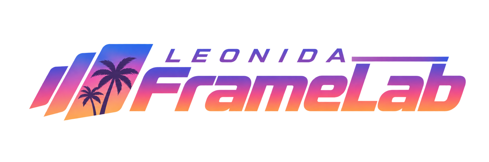
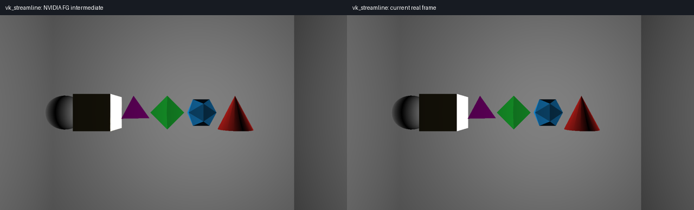

<p align="center"></p>
<p align="center"><strong>FrameLab SDK core for temporal frame inputs, with NVIDIA DLSS validation samples.</strong></p>
<p align="center"><a href="README.md">English</a> · <a href="README_RU.md">Русский</a> · <a href="docs/BUILD.md">Build</a> · <a href="docs/phase3/VALIDATION.en.md">Evidence</a> · <a href="docs/ROADMAP.md">Roadmap</a></p>
<p align="center">   <a href="https://github.com/5headsmartbtw/leonida-framelab/actions/workflows/contract-tests.yml"></a></p>

Want to help? See the [contribution rules](CONTRIBUTING.md) and [claim a task in Issues](https://github.com/5headsmartbtw/leonida-framelab/issues/4).

## FrameLab SDK

The SDK core installs a C ABI for FG input validation, frame sequencing and resource leases. Build it as a static or shared library and link from an external C/C++ project with `FrameLab::FrameLab`. The public header and default build use no game or GPU SDK headers. See [SDK setup and lifecycle](docs/sdk/README.md) and the [experimental release checklist](docs/sdk/RELEASE_CHECKLIST.md).

The optional [D3D12 FG component](docs/sdk/D3D12_FG.md) records real NGX work from an external app and retains resources through its completion fence. Native Vulkan FG and Streamline SR are still exercised separately in the reference sample.

## What is the testbed?

**Leonida FrameLab** is an experimental research and validation project for **NVIDIA DLSS Frame Generation and Super Resolution**, intended to prepare a careful future integration with [Leonida](https://github.com/ItsNotRexed/Leonida).

The repository brings together a working Windows Vulkan/D3D12 FG testbed, an API-neutral **FrameInputs** contract, CPU/GPU validation evidence and a read-only audit of Leonida's presentation pipeline. It focuses on proving that frames are actually computed, checking the image and handling resource lifetime correctly.

**It is not a finished FG/SR backend for Leonida or a game mod installer.** Leonida's backend has not been modified. Real game depth, motion vectors and camera bindings have not been identified. Unavailable inputs are rejected; they are never invented to make a capability check pass.

## Current status

| Area | Verified result | Boundary |
|---|---|---|
| Direct NGX FG / D3D12 | Feature creation, Evaluate, readback and real/generated Present on RTX 2050 | Independent synthetic baseline |
| Direct NGX FG / native Windows Vulkan | Working 2X in the sample's own animated 3D scene | External SM86 dependency + experimental Vulkan layer |
| DLSS Super Resolution / Streamline | 120 successful Evaluate calls, Vulkan validation 0/0 on RTX 2050 | Combined SR + FG is unverified |
| FrameInputs Phase 3 | 59 checks, baseline-identical control image, tested missing-depth fallback | Current GPU consumer is Vulkan-only, one command stream |
| VSync / resize / FG toggle | Live Immediate↔FIFO, resize to 1920×1009, disable/re-enable; validation 0/0 | API Present counts are not physical scanout or latency |
| Leonida integration | Pipeline audited, concrete integration plan written | Required game semantics and completion/lifetime seam still missing |

Published hardware evidence comes from a single **RTX 2050 Laptop, SM 8.6, 4 GB** with Windows 11 and NVIDIA 617.14. Independent replication is open. See [validation](docs/phase3/VALIDATION.en.md) and the [coordination thread](https://github.com/5headsmartbtw/leonida-framelab/issues/4).

## Why FrameInputs matters

A back buffer alone is not enough for reliable temporal frame generation. The consumer needs the correct color, depth, motion vectors, camera/jitter, dimensions and frame history **for the same source frame**. It also needs to know when the GPU may read them and who keeps their allocations alive.

`fg/FrameInputs.hpp` contains the API-neutral contract. `fg/FrameInputsVulkan.hpp` resolves it to typed Vulkan bindings. Invalid metadata falls back to the normal real-frame Present **before NGX or new image barriers are recorded**, and the next valid frame resets history. The sample retains actual GBuffer/allocator owners until GPU completion.

See [contract](docs/phase3/CONTRACT.en.md) and [architecture](docs/ARCHITECTURE.md).

## Run the portable tests

```sh
cmake -S . -B build
cmake --build build --config Release
ctest --test-dir build -C Release --output-on-failure
```

The neutral contract tests need only CMake and a C++20 compiler. Vulkan binding tests are added when headers are available, or with `-DFRAMEINPUTS_VULKAN_INCLUDE=/path/to/Vulkan/Include`. No GPU, game, NVIDIA SDK download or proprietary binary is required for the default build.

The Windows GPU sample is opt-in. Point CMake and the runtime at separately acquired dependencies. The GPU runner accepts an explicit executable and writes results to a new log directory on each run. See [build and reproduce](docs/BUILD.md).

## Evidence, not just a loaded DLL

- **VSync Off:** 6 Evaluate, 5 verified intermediate images, 6 real + 5 generated Present, validation 0 errors / 0 warnings.
- **VSync On:** the same checks passed in FIFO mode.
- **Missing depth:** source frame 2 was rejected before NGX; 6 real Present continued, the next valid frame reset history, FG recovered.
- **Baseline comparison:** the deterministic RGBA16F output matched the preserved baseline byte for byte.
- **Live test:** 10,605 source frames, 7,380 Evaluate, 7,375 generated Present; FG errors 0, input rejections 0, validation 0/0.

See the [Phase 3 logs](docs/phase3/evidence) and [validation report](docs/phase3/VALIDATION.en.md). The original local sample baseline is `a175d35f01a7c172429f79af27b6c6d43704b6b9` and the Phase 3 snapshot is `b017e469d740e167dc45db95c67b0737d3d4594b`. These revisions identify the source checkout used for those measurements.


<sub>Own synthetic scene, diagnostic readback. This is not a screenshot or frame from GTA VI.</sub>

## Repository map

| Directory | Purpose |
|---|---|
| `fg/` | API-neutral contract and typed Vulkan validation |
| `tests/` | CPU tests and local GPU reproduction script |
| `sample/` | NVIDIA Vulkan sample derivative with direct NGX FG, SR reference path and VSync controls |
| `native/windows/` | MIT-derived Windows Vulkan CUDA module layer/probe |
| `experiments/d3d12/` | Independent D3D12 FG/capability baseline |
| `docs/phase3/` | [Contract, audit, validation evidence and integration plan](docs/phase3/README.en.md) |
| `LICENSES/` | Original third-party license texts |

## What comes next?

The open milestones include independent hardware replication, a tested multi-queue consumer and an SR + FG experiment in the synthetic scene. Leonida integration also needs a verified semantic resource provider. See the [roadmap](docs/ROADMAP.md), [pipeline audit](docs/phase3/LEONIDA_AUDIT.en.md) and [integration plan](docs/phase3/INTEGRATION_PLAN.en.md).

The original Streamline Vulkan FG preflight can still report `AdapterUnsupported`. Its result is not overridden; the verified direct-NGX path is a separate backend. HDR, arbitrary subresources, game inputs, device-loss recovery and production frame pacing remain outside the validated profile.

## License and credits

Original project contributions are **MIT**, Copyright © 2026 **[5headsmartbtw](https://github.com/5headsmartbtw)**. Keep the copyright and license notice when reusing them. Imported NVIDIA sample portions retain Apache-2.0; the dlssg-open-derived port retains its original MIT attribution. See [LICENSE](LICENSE) and [NOTICE.md](NOTICE.md).

Thanks to [nvpro-samples/vk_streamline](https://github.com/nvpro-samples/vk_streamline), [dniminenn/dlssg-open](https://github.com/dniminenn/dlssg-open), the Streamline/DLSS teams and Leonida contributors. NVIDIA SDKs/runtime DLLs/kernels and game files are **not distributed** here. Obtain external dependencies under their own terms.

Special thanks to @akimfomin from PortBridge for independently reproducing our Vulkan handoff tests on an RTX 4070 Ti SUPER.
