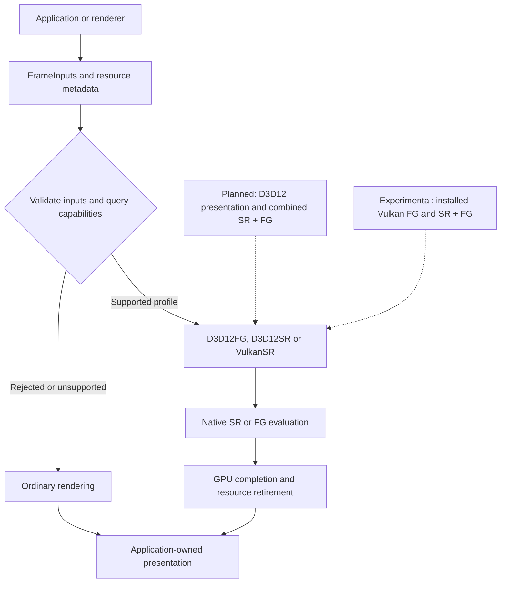

<p align="center"></p>
<p align="center"><strong>An independent experimental rendering SDK for temporal frame processing and reproducible graphics validation.</strong></p>
<p align="center"><a href="README.md">English</a> · <a href="README_RU.md">Русский</a> · <a href="docs/BUILD.md">Build</a> · <a href="docs/evidence/independent-vulkan-handoff.md">Evidence</a> · <a href="docs/ROADMAP.md">Roadmap</a></p>
<p align="center">   <a href="https://github.com/5headsmartbtw/leonida-framelab/actions/workflows/contract-tests.yml"></a></p>

FrameLab provides an installable C ABI for temporal frame metadata, GPU resource lifetime and NVIDIA DLSS integration. External renderers can link from C or C++ using public C headers or the raw Rust bindings. Original synthetic workloads exercise native Super Resolution (SR), Frame Generation (FG), image readback and fallback on specific tested profiles.

The project grew out of research for [Leonida](docs/integrations/leonida/README.md). FrameLab builds and tests independently of downstream renderers. Integration with a GTA VI renderer remains research, and the SDK does not install game mods or establish game compatibility.

[FrameLab SDK v0.4.0 release notes](docs/sdk/RELEASE_NOTES.md) cover the experimental package, verified hardware profiles and open gates.

## SDK and backend status

| Capability | Status | Evidence and boundary |
| --- | --- | --- |
| Portable FrameInputs C ABI | Merged | Versioned metadata, frame sequencing and resource leases. [#7](https://github.com/5headsmartbtw/leonida-framelab/pull/7) |
| SDK install and C/C++ consumers | Merged | Static/shared CMake packages and external consumers on Windows and Linux. [#7](https://github.com/5headsmartbtw/leonida-framelab/pull/7) |
| Rust FFI | Merged | Raw bindings with C layout and installed shared-library lifecycle checks. [#11](https://github.com/5headsmartbtw/leonida-framelab/pull/11) |
| D3D12 FG | Merged | Optional Windows x64 component. Native Direct NGX, verified readback and fence retirement. [#19](https://github.com/5headsmartbtw/leonida-framelab/pull/19) |
| D3D12 SR | Merged | Optional Windows x64 Direct NGX component with verified readback and real fence retirement. [D3D12SR](docs/sdk/D3D12_SR.md) · [#36](https://github.com/5headsmartbtw/leonida-framelab/pull/36) |
| D3D12 generated-frame DXGI presentation | Planned for installed client | The [older standalone presenter](experiments/d3d12/README.md) verified real and generated Present. The installed client verified readback. [FL-15](https://github.com/5headsmartbtw/leonida-framelab/issues/30) |
| D3D12 SR + FG | Planned | Depends on FL-14 and the presentation work in FL-15. [FL-16](https://github.com/5headsmartbtw/leonida-framelab/issues/31) |
| Vulkan FG | Experimental · open draft | Legacy sample in main. Installed Direct NGX and readback verified in [#20](https://github.com/5headsmartbtw/leonida-framelab/pull/20). Release blocked by [#24](https://github.com/5headsmartbtw/leonida-framelab/issues/24). |
| Vulkan SR | Merged | Optional Windows x64 Streamline component. Verified readback, resize/reset and timeline retirement. [#22](https://github.com/5headsmartbtw/leonida-framelab/pull/22) |
| Vulkan SR + FG | Experimental · open draft | Native SR output feeds FG on one command stream. Reference readback, resize and fallback verified. [#23](https://github.com/5headsmartbtw/leonida-framelab/pull/23) |
| Vulkan queue handoff | Merged fixture · experimental SDK paths | Standalone binary/timeline waits and family ownership in [#12](https://github.com/5headsmartbtw/leonida-framelab/pull/12). Installed FG and combined paths in [#20](https://github.com/5headsmartbtw/leonida-framelab/pull/20) and [#27](https://github.com/5headsmartbtw/leonida-framelab/pull/27). |
| Vulkan failure recovery | Experimental · open draft | Injected rejection, simulated loss, lease retention and fresh-process recovery. Native driver loss and same-process recovery remain unverified. [#26](https://github.com/5headsmartbtw/leonida-framelab/pull/26) |
| External renderer integration | In development | Installed SDK linkage is in main. Cauldron has a local checkpoint. Leonida and VIctory have [read-only audits](https://github.com/5headsmartbtw/leonida-framelab/pull/10). |

## Architecture



The portable layer checks same-frame color, depth, motion vectors, camera/jitter, extents and temporal continuity. Backends validate native bindings and capabilities and record GPU work. The host owns submission and presentation. Resource leases survive until the applicable native fence or timeline completes. The diagram shows both supported and prospective paths. Each component's contract defines its inputs, completion primitive and fallback behavior. [Architecture](docs/ARCHITECTURE.md) · [C ABI and lifecycle](docs/sdk/README.md)

## Hardware evidence

| Device | Verified workload | Evidence |
| --- | --- | --- |
| RTX 2050 Laptop (4 GB) | Low-memory reference. Installed D3D12 FG, D3D12 SR and Vulkan SR readback. Standalone Vulkan handoff and additional Vulkan validation in open PRs. D3D12 SR used the official runtime. FG used the experimental SM86 profile. | [D3D12 FG](docs/sdk/D3D12_FG.md) · [D3D12 SR](docs/sdk/D3D12_SR.md) · [Vulkan SR](docs/sdk/VULKAN_SR.md) · [#12](https://github.com/5headsmartbtw/leonida-framelab/pull/12) · [#24](https://github.com/5headsmartbtw/leonida-framelab/issues/24) |
| RTX 4070 Ti SUPER | Standalone Vulkan handoff, all four scenarios. | [akimfomin's report](https://github.com/5headsmartbtw/leonida-framelab/pull/12#issuecomment-7142089405) |
| RTX 5090 | Official-runtime D3D12 SR readback and lifecycle tests in [#36](https://github.com/5headsmartbtw/leonida-framelab/pull/36). Native Vulkan FG and generated-image readback from draft #20 with an official, unmodified NVIDIA runtime. SyncVal reproduced write-after-write diagnostics. | [JoeY54's report](https://github.com/5headsmartbtw/leonida-framelab/issues/24#issuecomment-7148188121) |
| Radeon 860M | Standalone Vulkan handoff, all four scenarios. | [JoeY54's report](https://github.com/5headsmartbtw/leonida-framelab/issues/15#issuecomment-7147944059) |
| Ryzen 9 9950X3D integrated Radeon graphics | Standalone Vulkan handoff, all four scenarios. | [JoeY54's report](https://github.com/5headsmartbtw/leonida-framelab/issues/15#issuecomment-7153817545) |

Standalone handoff validates binary/timeline waits, queue-family ownership and exact readback. DLSS support is evaluated separately. The experimental RTX 2050 FG result does not establish official NVIDIA FG support on RTX 20- or 30-series GPUs. [Independent handoff evidence](docs/evidence/independent-vulkan-handoff.md) · [Accepted AMD review](https://github.com/5headsmartbtw/leonida-framelab/pull/33)

## Synthetic performance and stability

[Open telemetry PR #25](https://github.com/5headsmartbtw/leonida-framelab/pull/25) measured a synthetic Vulkan scene on the RTX 2050 Laptop, Windows 11 build 26200, NVIDIA driver 617.14, Vulkan SDK 1.4.363.1 and Streamline 2.14.1. FG used the reference experimental Windows layer and external SM86 0.4.2 / bundled 310.9.16 runtime. The [fixed-display benchmark](https://github.com/5headsmartbtw/leonida-framelab/blob/f78bab5dfa835132b84e2dc59c162e5b733cedb2/docs/sdk/VULKAN_TELEMETRY.md#fixed-display-benchmark) used [`400d7c7`](https://github.com/5headsmartbtw/leonida-framelab/commit/400d7c73c2fcca7b105fcfc8c7a156ce6f378021), **1280×720 output at 75 Hz**, and 180 source frames per profile with the first 30 excluded. Timing runs disabled validation and diagnostic readback. [Reference runtime evidence](https://github.com/5headsmartbtw/leonida-framelab/issues/24)

| Profile | VSync / present mode | Render size | Source FPS | Mean / P99 interval (ms) | GPU (ms) | Working set (MiB) | Device-local VRAM (MiB) |
| --- | --- | --- | ---: | ---: | ---: | ---: | ---: |
| Native | Off / Immediate | 1280×720 | 179.90 | 5.56 / 6.14 | 0.11 | 403.9–404.0 | 99.9–99.9 |
| Native | On / FIFO | 1280×720 | 74.97 | 13.34 / 14.05 | 0.12 | 371.3–371.4 | 96.1–96.1 |
| SR | Off / Immediate | 640×360 | 177.42 | 5.64 / 6.96 | 2.68 | 384.6–384.7 | 189.1–189.1 |
| SR | On / FIFO | 640×360 | 74.93 | 13.35 / 14.27 | 3.18 | 381.5–381.6 | 185.3–185.3 |
| FG | Off / Immediate | 1280×720 | 144.08 | 6.94 / 8.09 | 5.03 | 417.0–417.0 | 246.8–246.8 |
| FG | On / FIFO | 1280×720 | 37.49 | 26.68 / 27.71 | 6.94 | 414.3–414.6 | 243.1–243.1 |
| SR + FG | Off / Immediate | 640×360 | 99.28 | 10.07 / 11.41 | 7.93 | 427.4–427.4 | 322.5–322.5 |
| SR + FG | On / FIFO | 640×360 | 37.48 | 26.68 / 27.65 | 8.63 | 422.7–422.8 | 318.7–318.7 |

GPU time sums the recorded Vulkan work. The working set is Windows RSS and VRAM is sampled device-local heap usage from Vulkan's memory-budget extension. These source-frame rates describe this workload. Present counters in the detailed evidence are API calls. Physical scanout and input latency were unmeasured, and the benchmark does not predict GTA VI or other game performance.

The [separate stability runs](https://github.com/5headsmartbtw/leonida-framelab/blob/f78bab5dfa835132b84e2dc59c162e5b733cedb2/docs/sdk/VULKAN_TELEMETRY.md#stepped-stability-runs) completed **120, 500, 1,000 and 10,000 source frames** per SR, FG and combined profile. They used the same reference GPU and runtime, with VSync off, standard validation and three alternating resizes. Each final run drained with zero standard validation errors or warnings. The combined run used one command stream and [`cd19b21`](https://github.com/5headsmartbtw/leonida-framelab/commit/cd19b21d7a238042619b49574b7d0a58ad807662) after a teardown fix. Extended SyncVal remains a separate gate.

| 10,000-frame profile | SR / FG evaluations | Verified SR / FG readbacks | Peak working set (MiB) | Peak device-local VRAM (MiB) |
| --- | ---: | ---: | ---: | ---: |
| SR / `400d7c7` | 10,000 / 0 | 5 / 0 | 415.6 | 232.8 |
| FG / `400d7c7` | 0 / 10,000 | 0 / 100 | 471.4 | 246.8 |
| SR + FG / `cd19b21` | 10,000 / 10,000 | 5 / 100 | 497.4 | 428.2 |

## Quick start

### CPU-only contract tests

CMake 3.20+ and a C++20 compiler are sufficient for the default portable build. Vulkan headers optionally enable CPU-only binding tests. The default build needs no GPU, proprietary runtime or game files.

```sh
cmake -S . -B build -DCMAKE_BUILD_TYPE=Release
cmake --build build --config Release
ctest --test-dir build -C Release --output-on-failure
```

### Standalone Vulkan GPU handoff

Use a Vulkan 1.2+ device, Vulkan SDK and Khronos validation layers. This is a standalone executable for compatible AMD, Intel or NVIDIA devices. It requests synchronization validation, checks all 64 pixels after the consumer fence and reports unsupported queue configurations as skips. [Fixture and requirements](tests/vulkan-handoff/README.md)

```sh
cmake -S tests/vulkan-handoff -B build-handoff -DCMAKE_BUILD_TYPE=Release
cmake --build build-handoff --config Release
ctest --test-dir build-handoff -C Release -V
```

### Install the SDK for an external app

```sh
cmake -S . -B build-sdk -DBUILD_SHARED_LIBS=OFF -DBUILD_TESTING=OFF -DCMAKE_BUILD_TYPE=Release
cmake --build build-sdk --config Release
cmake --install build-sdk --config Release --prefix ./install
```

```cmake
find_package(FrameLab 0.4.0 EXACT CONFIG REQUIRED)
target_link_libraries(my_renderer PRIVATE FrameLab::FrameLab)
```

Point the consumer's `CMAKE_PREFIX_PATH` at the install prefix and include `<framelab/framelab.h>`. For a shared build, configure a separate build directory with `BUILD_SHARED_LIBS=ON`. The opt-in Windows x64 GPU modules use separately obtained dependencies. See [C/C++ installation and examples](docs/sdk/README.md), [D3D12FG](docs/sdk/D3D12_FG.md), [D3D12SR](docs/sdk/D3D12_SR.md), [VulkanSR](docs/sdk/VULKAN_SR.md), [Rust FFI](bindings/rust/README.md) and [NVIDIA sample setup](docs/BUILD.md).

## Limits and release blockers

- **Native Vulkan FG SyncVal remains unresolved.** The RTX 2050 experimental profile and RTX 5090 official runtime both produced eight write-after-write diagnostics inside NGX Evaluate in their two-frame installed and legacy traces. Standard Vulkan validation reported zero errors and warnings in the tested cases. On the RTX 5090 the strict standard runner still failed on separate libpng stderr warnings. The recording boundary locates the symptoms. The responsible component is still unknown. [Incident and reproducer](https://github.com/5headsmartbtw/leonida-framelab/issues/24) · [Independent results](https://github.com/5headsmartbtw/leonida-framelab/issues/24#issuecomment-7148188121)
- **Low-memory compatibility is a merge requirement.** The maintainer compares revisions at 720p on the 4 GB RTX 2050 before accepting relevant GPU changes. RTX 5090 results add development and stress coverage. Capabilities, optional fallback, ABI compatibility and actual GPU completion remain part of the [release checklist](docs/sdk/RELEASE_CHECKLIST.md).
- **Verified profiles are narrow.** Native driver-loss recovery, broad HDR and subresource coverage, production pacing and game inputs remain unverified. The tested rejection and simulated loss paths in [#26](https://github.com/5headsmartbtw/leonida-framelab/pull/26) have their own evidence.

## Roadmap and external renderers

- D3D12 next steps are [installed-client DXGI presentation (FL-15)](https://github.com/5headsmartbtw/leonida-framelab/issues/30) and [combined SR + FG (FL-16)](https://github.com/5headsmartbtw/leonida-framelab/issues/31).
- Vulkan priorities are [SyncVal root cause (FL-17)](https://github.com/5headsmartbtw/leonida-framelab/issues/32), review of queue and failure handling, and broader independent hardware validation. See the [roadmap](docs/ROADMAP.md) and [stabilization roadmap update #28](https://github.com/5headsmartbtw/leonida-framelab/pull/28).
- The local AMD FidelityFX Cauldron checkpoint linked the installed SDK, loaded its DLL, checked the ABI and continued standard Sponza rendering. A later standalone signed Streamline probe initialized the runtime and queried DLSS requirements. Native Cauldron SR and FG evaluation remain in development. The public integration proposal is in [#28](https://github.com/5headsmartbtw/leonida-framelab/pull/28).
- Leonida and VIctory remain optional downstream integrations. See the [read-only integration notes](docs/integrations/leonida/README.md) and [VIctory audit](docs/integrations/victory/README.md).

## Contribute

- **CPU only:** run the default build or pick a contract or CI task such as FL-01.
- **AMD or Intel:** use the standalone Vulkan handoff fixture and report the exact device, driver and supported or skipped cases.
- **RTX 20/30 series:** start with portable tests, standalone Vulkan and supported SR. Record the native capability result and label any separately documented experimental FG configuration.
- **RTX 40/50 series:** use the pinned [installed Vulkan FG draft instructions](https://github.com/5headsmartbtw/leonida-framelab/blob/a27e66b6a516695a74f21f1ab86ae709fdaa0347/docs/sdk/VULKAN_FG.md#reference-consumer-and-verification) with a compatible official runtime. Report readback, standard validation and SyncVal separately. See FL-08 and related claims on the board.
- **SDK development:** use the external C/C++ smoke tests or Rust bindings, and check the D3D12 and Vulkan tasks above.

In [Coordination #4](https://github.com/5headsmartbtw/leonida-framelab/issues/4), post `/claim FL-01` as the first line of a new comment to claim an available task. Use `/progress FL-01` to report progress and `/unclaim FL-01` to release it. Substitute the actual task ID. Standard Git, CMake and a compiler are enough. AI tooling is optional. Follow the [contribution guide](CONTRIBUTING.md).

## Repository map

| Path | Purpose |
| --- | --- |
| `include/framelab/`, `src/`, `fg/` | Public headers, SDK implementation and API-neutral frame contracts |
| `bindings/rust/`, `samples/rust_d3d12/`, `tests/external-consumer/` | Rust FFI, native Rust D3D12 SR/FG consumers and installed C/C++ consumer checks |
| `tests/vulkan-handoff/`, `tests/` | Standalone queue validation, portable tests and GPU runners |
| `sample/`, `samples/d3d12_fg/`, `experiments/d3d12/` | Vulkan reference, installed D3D12 FG client and older standalone D3D12 experiments |
| `native/windows/`, `docs/`, `LICENSES/` | Experimental Windows layer, implementation/evidence guides and upstream license texts |

## Contributors

| Contributor | Contributions |
| --- | --- |
| [@5headsmartbtw](https://github.com/5headsmartbtw) | Founder, maintainer, SDK architecture and development |
| [@JoeY54](https://github.com/JoeY54) | D3D12 SR development, Vulkan SyncVal research and independent GPU validation |
| [@akimfomin](https://github.com/akimfomin) | Independent Vulkan validation and PortBridge coordination |

## License and credits

Original project contributions are **MIT**, Copyright © 2026 **[5headsmartbtw](https://github.com/5headsmartbtw)**. Retain the copyright and license notice. Imported [NVIDIA vk_streamline](https://github.com/nvpro-samples/vk_streamline) portions retain Apache-2.0. The [dlssg-open](https://github.com/dniminenn/dlssg-open)-derived port retains its original MIT attribution. [LICENSE](LICENSE) · [NOTICE.md](NOTICE.md)

Thanks to the DLSS/Streamline teams and Leonida contributors, to **[@JoeY54](https://github.com/JoeY54)** for both independent AMD reports and RTX 5090 validation, and to **[@akimfomin](https://github.com/akimfomin)** for RTX 4070 Ti SUPER handoff validation and [PortBridge](https://github.com/akimfomin/PortBridge) coordination.

Use original synthetic or appropriately licensed inputs and follow the [No Game Files policy](CONTRIBUTING.md#no-gta-vi-game-files). Obtain NVIDIA SDKs, runtimes and other proprietary dependencies separately under their respective terms.
