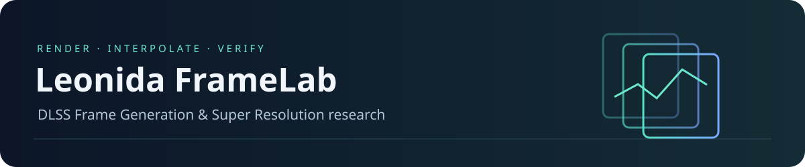
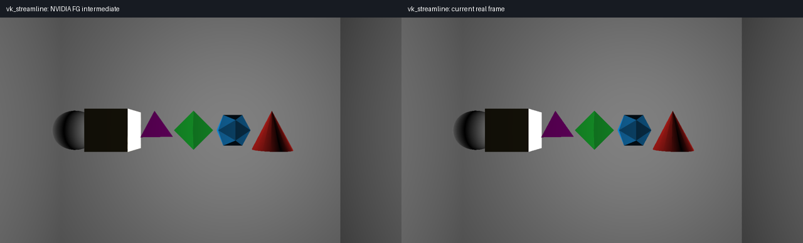

<p align="center"></p>
<p align="center"><strong>Разобраться в кадре. Сгенерировать. Проверить результат.</strong></p>
<p align="center"><a href="README.md">English</a> · <a href="README_RU.md">Русский</a> · <a href="docs/BUILD.md">Сборка</a> · <a href="docs/phase3/VALIDATION.md">Проверки</a> · <a href="docs/ROADMAP.md">План</a></p>

## Что это за проект?

**Leonida FrameLab** — экспериментальный стенд **NVIDIA DLSS Frame Generation и Super Resolution** для подготовки будущей интеграции с [Leonida](https://github.com/ItsNotRexed/Leonida).

Здесь собраны работающие Windows Vulkan/D3D12 FG-прототипы, независимый от графического API контракт **FrameInputs**, проверки изображений и времени жизни ресурсов, а также аудит реального Vulkan-пути Leonida. Главная цель — подтвердить вычисление кадров и корректную передачу входов, а не остановиться на загрузке DLL или успешной проверке поддержки.

**Готового FG/SR backend для Leonida или установщика игрового мода здесь пока нет.** Backend Leonida не изменён. Игровые depth/MV/camera не идентифицированы. Если данные недостоверны или отсутствуют, используется обычный Present; вымышленные буферы не подставляются.

## Что уже подтверждено

| Направление | Результат | Граница проверки |
|---|---|---|
| Direct NGX FG / D3D12 | Создание feature, Evaluate, readback и real/generated Present на RTX 2050 | Самостоятельная синтетическая сцена |
| Direct NGX FG / Windows Vulkan | Рабочий 2X на собственной анимированной 3D-сцене sample | Внешний SM86-мод и экспериментальный Vulkan layer |
| DLSS Super Resolution / Streamline | 120 успешных Evaluate в ранней SR-проверке | Отдельный режим; SR и direct FG вместе ещё не проверены |
| FrameInputs Phase 3 | 59 проверок, побайтное совпадение контрольного кадра, fallback при missing depth | GPU consumer пока только Vulkan и один command stream |
| VSync, resize и переключатель FG | Immediate↔FIFO, resize до 1920×1009, выключение/включение FG; validation 0/0 | Present API — не измерение физического показа или задержки |
| Интеграция Leonida | Аудит pipeline и конкретный план | Семантика игровых входов, lifetime и completion seam ещё не готовы |

Стенд: **RTX 2050 Laptop, SM 8.6, 4 ГБ**, Windows 11, драйвер NVIDIA 617.14. Это измеренный результат одной конфигурации, а не обещание совместимости со всеми Ampere GPU, драйверами и играми.

## Зачем нужен FrameInputs?

Одного back buffer недостаточно. Для одного исходного кадра нужны согласованные color, depth, motion vectors, camera matrices/jitter, размеры и reset истории. Consumer должен знать, когда GPU может читать эти данные и кто удерживает их allocations.

`fg/FrameInputs.hpp` описывает общий C++20 контракт без Vulkan/D3D/Streamline/NGX типов. `fg/FrameInputsVulkan.hpp` связывает его с конкретными Vulkan-объектами. Некорректный пакет отклоняется **до NGX и новых image barriers**, real Present продолжается, следующий корректный кадр сбрасывает историю. Sample удерживает настоящие GBuffer и allocator до завершения GPU.

Подробности: [контракт](docs/phase3/CONTRACT.md), [архитектура](docs/ARCHITECTURE.md), [аудит Leonida](docs/phase3/LEONIDA_AUDIT.md).

## Быстрый запуск тестов

```sh
cmake -S . -B build
cmake --build build --config Release
ctest --test-dir build -C Release --output-on-failure
```

Для общего контракта достаточно CMake и компилятора C++20. Vulkan binding tests добавятся при наличии заголовков SDK либо параметра `-DFRAMEINPUTS_VULKAN_INCLUDE=/путь/к/Vulkan/Include`. GPU, игра и NVIDIA SDK для обычной сборки тестов не нужны.

GPU sample включается отдельно и пока сохраняет пути исходного валидированного стенда. Это ещё не переносимый установщик: см. [BUILD.md](docs/BUILD.md) и [sample/README.md](sample/README.md). Переносимость runtime paths вынесена в roadmap.

## Доказательства работы

- VSync Off: 6 Evaluate, 5 проверенных промежуточных изображений, 6 real + 5 generated Present, validation 0 ошибок / 0 предупреждений.
- VSync On: тот же набор прошёл в FIFO.
- При отсутствии depth на source frame 2 NGX не вызывается, обычный вывод продолжается; следующий корректный кадр сбрасывает историю и восстанавливает FG.
- Контрольный RGBA16F результат побайтно совпал с baseline.
- Живая серия: 10 605 исходных кадров, 7 380 Evaluate, 7 375 generated Present; ошибок FG, отклонённых входов и ошибок validation — 0.

Логи и команды находятся в [VALIDATION.md](docs/phase3/VALIDATION.md) и [evidence](docs/phase3/evidence). Baseline исходного локального checkout: `a175d35f01a7c172429f79af27b6c6d43704b6b9`; завершённая Phase 3: `b017e469d740e167dc45db95c67b0737d3d4594b`. Это ссылки на происхождение снимка, а не коммиты новой истории этого репозитория.


<sub>Собственная тестовая сцена. Это не кадр GTA VI.</sub>

## Что внутри

`fg/` — контракт и Vulkan binding validation; `tests/` — CPU-тесты и локальный GPU runner; `sample/` — Vulkan sample с Direct NGX FG и отдельным SR-путём; `native/windows/` — Windows layer/probe; `experiments/d3d12/` — D3D12 baseline; `docs/phase3/` — аудит, проверки и план; `LICENSES/` — лицензии использованных компонентов.

## Что дальше

Сначала — проверенный consumer с внешними completion signals и несколькими очередями. Затем — достоверный semantic provider ресурсов. Только после этого можно подключаться к Leonida, сохраняя resource→tracker→submit порядок блокировок, rollback layouts, deferred presents и frame tokens. См. [roadmap](docs/ROADMAP.md) и [план интеграции](docs/phase3/INTEGRATION_PLAN.md).

Исходный FG-плагин Streamline Vulkan всё ещё может сообщать `AdapterUnsupported`. Эта проверка не подменяется успехом; работающий direct NGX — отдельный backend. HDR, игровые входы, произвольные subresources, device-lost recovery и production pacing не входят в проверенный профиль.

## Лицензия и авторство

Новый код проекта — **MIT**, Copyright © 2026 **[5headsmartbtw](https://github.com/5headsmartbtw)**. При использовании сохраняются copyright и текст лицензии. Исходные NVIDIA sample-компоненты сохраняют Apache-2.0; порт из dlssg-open — MIT с оригинальным авторством. См. [LICENSE](LICENSE) и [NOTICE.md](NOTICE.md).

Спасибо [nvpro-samples/vk_streamline](https://github.com/nvpro-samples/vk_streamline), [dniminenn/dlssg-open](https://github.com/dniminenn/dlssg-open), разработчикам DLSS/Streamline и участникам Leonida. NVIDIA SDK, DLL, kernels и игровые файлы **не распространяются** в этом репозитории; внешние зависимости получают отдельно на их условиях.
