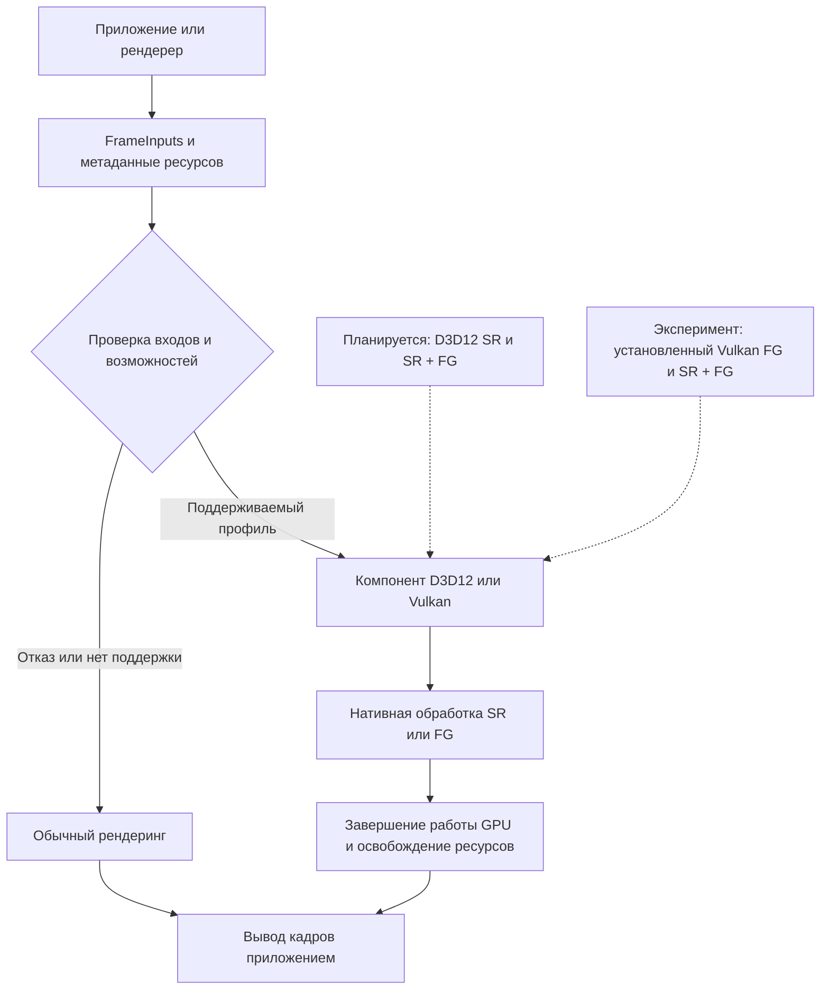

<p align="center"></p>
<p align="center"><strong>Независимый экспериментальный SDK для временной обработки кадров и воспроизводимых графических проверок.</strong></p>
<p align="center"><a href="README.md">English</a> · <a href="README_RU.md">Русский</a> · <a href="docs/BUILD.md">Сборка</a> · <a href="docs/evidence/independent-vulkan-handoff.md">Проверки</a> · <a href="docs/ROADMAP.md">План</a></p>
<p align="center">   <a href="https://github.com/5headsmartbtw/leonida-framelab/actions/workflows/contract-tests.yml"></a></p>

FrameLab предоставляет устанавливаемый C ABI для метаданных временной обработки кадров, управления временем жизни ресурсов GPU и интеграции NVIDIA DLSS. Внешние рендереры могут подключаться из C и C++ через публичные C-заголовки или использовать низкоуровневые привязки Rust. На собственных синтетических сценах проверяются нативные Super Resolution (SR), Frame Generation (FG), чтение изображений и возврат к обычному рендерингу на конкретных конфигурациях.

Проект вырос из исследований для [Leonida](https://github.com/ItsNotRexed/Leonida). FrameLab собирается и тестируется независимо от внешних рендереров. Интеграция с рендерером GTA VI остаётся исследовательской задачей. SDK не устанавливает моды и не подтверждает совместимость с игрой.

## Состояние SDK и компонентов

| Возможность | Состояние | Проверки и границы |
| --- | --- | --- |
| Переносимый C ABI FrameInputs | В main | Версионируемые метаданные, проверка последовательности кадров и удержание ресурсов. [#7](https://github.com/5headsmartbtw/leonida-framelab/pull/7) |
| Установка SDK и клиенты на C/C++ | В main | Статический и динамический пакеты CMake, внешние клиенты на Windows и Linux. [#7](https://github.com/5headsmartbtw/leonida-framelab/pull/7) |
| Rust FFI | В main | Низкоуровневые привязки с проверкой раскладки C ABI и жизненного цикла установленной библиотеки. [#11](https://github.com/5headsmartbtw/leonida-framelab/pull/11) |
| D3D12 FG | В main | Необязательный компонент Windows x64. Нативный Direct NGX, проверка изображения и освобождение по fence. [#19](https://github.com/5headsmartbtw/leonida-framelab/pull/19) |
| D3D12 SR | Запланировано | Необязательный устанавливаемый компонент. [FL-14](https://github.com/5headsmartbtw/leonida-framelab/issues/29) |
| Вывод сгенерированных кадров через D3D12/DXGI | Запланировано для клиента SDK | [Ранний отдельный пример](experiments/d3d12/README.md) проверил Present обычных и сгенерированных кадров. Клиент установленного SDK проверил чтение изображения. [FL-15](https://github.com/5headsmartbtw/leonida-framelab/issues/30) |
| D3D12 SR + FG | Запланировано | Зависит от FL-14 и вывода кадров из FL-15. [FL-16](https://github.com/5headsmartbtw/leonida-framelab/issues/31) |
| Vulkan FG | Эксперимент · открытый черновик | Прежний пример есть в main. Установленный Direct NGX и чтение результата проверены в [#20](https://github.com/5headsmartbtw/leonida-framelab/pull/20). Релиз блокирует [#24](https://github.com/5headsmartbtw/leonida-framelab/issues/24). |
| Vulkan SR | В main | Необязательный компонент Streamline для Windows x64. Проверены чтение результата, resize, сброс истории и освобождение по timeline. [#22](https://github.com/5headsmartbtw/leonida-framelab/pull/22) |
| Vulkan SR + FG | Эксперимент · открытый черновик | Нативный результат SR поступает в FG в одном потоке команд. Проверены чтение результата, resize и fallback. [#23](https://github.com/5headsmartbtw/leonida-framelab/pull/23) |
| Передача ресурсов между очередями Vulkan | Отдельный тест в main · пути SDK экспериментальны | Отдельный тест binary/timeline и передачи владения в [#12](https://github.com/5headsmartbtw/leonida-framelab/pull/12). Пути установленного FG и совместного режима — в [#20](https://github.com/5headsmartbtw/leonida-framelab/pull/20) и [#27](https://github.com/5headsmartbtw/leonida-framelab/pull/27). |
| Обработка сбоев Vulkan | Эксперимент · открытый черновик | Принудительный отказ отправки, имитация потери устройства, удержание ресурсов и восстановление в новом процессе. Реальная потеря устройства и восстановление в том же процессе не проверены. [#26](https://github.com/5headsmartbtw/leonida-framelab/pull/26) |
| Интеграция внешних рендереров | В разработке | Подключение установленного SDK доступно в main. У Cauldron есть локальный этап интеграции. Для Leonida и VIctory проведены [аудиты без изменения кода](https://github.com/5headsmartbtw/leonida-framelab/pull/10). |

## Архитектура



Переносимый слой проверяет цвет, глубину, векторы движения, камеру и jitter, размеры и непрерывность истории для одного исходного кадра. Компоненты API проверяют нативные привязки и возможности и записывают работу GPU. Приложение отправляет команды и выводит кадры. Ресурсы удерживаются до завершения соответствующего fence или timeline. Схема включает доступные и перспективные пути. Контракт каждого компонента определяет входы, примитив завершения и поведение при отказе. [Архитектура](docs/ARCHITECTURE.md) · [C ABI и жизненный цикл](docs/sdk/README.md)

## Проверенное оборудование

| Устройство | Проверенная нагрузка | Данные |
| --- | --- | --- |
| RTX 2050 Laptop (4 ГБ) | Эталон для ограниченной видеопамяти. Чтение результата установленного D3D12 FG, установленный Vulkan SR, отдельный тест передачи ресурсов и дополнительные проверки Vulkan в открытых PR. FG использовал экспериментальный профиль совместимости. | [D3D12 FG](docs/sdk/D3D12_FG.md) · [Vulkan SR](docs/sdk/VULKAN_SR.md) · [#12](https://github.com/5headsmartbtw/leonida-framelab/pull/12) · [#24](https://github.com/5headsmartbtw/leonida-framelab/issues/24) |
| RTX 4070 Ti SUPER | Отдельный тест передачи ресурсов между очередями Vulkan, все четыре сценария. | [Отчёт akimfomin](https://github.com/5headsmartbtw/leonida-framelab/pull/12#issuecomment-7142089405) |
| RTX 5090 | Нативный Vulkan FG и чтение сгенерированного изображения из черновика #20 с официальным неизменённым runtime NVIDIA. SyncVal воспроизвёл диагностику write-after-write. | [Отчёт JoeY54](https://github.com/5headsmartbtw/leonida-framelab/issues/24#issuecomment-7148188121) |
| Radeon 860M | Отдельный тест передачи ресурсов между очередями Vulkan, все четыре сценария. | [Отчёт JoeY54](https://github.com/5headsmartbtw/leonida-framelab/issues/15#issuecomment-7147944059) |
| Встроенная графика Radeon в Ryzen 9 9950X3D | Отдельный тест передачи ресурсов между очередями Vulkan, все четыре сценария. | [Отчёт JoeY54](https://github.com/5headsmartbtw/leonida-framelab/issues/15#issuecomment-7153817545) |

Отдельный тест проверяет ожидание binary/timeline, передачу владения между семействами очередей и точное чтение изображения. Поддержка DLSS проверяется отдельно. Экспериментальный результат RTX 2050 не подтверждает официальную поддержку NVIDIA FG на видеокартах серий RTX 20 и 30. [Независимые результаты](docs/evidence/independent-vulkan-handoff.md) · [Принятие отчётов AMD](https://github.com/5headsmartbtw/leonida-framelab/pull/33)

## Производительность и стабильность синтетической сцены

В [открытом PR #25](https://github.com/5headsmartbtw/leonida-framelab/pull/25) измерена синтетическая сцена Vulkan на RTX 2050 Laptop с Windows 11 build 26200, драйвером NVIDIA 617.14, Vulkan SDK 1.4.363.1 и Streamline 2.14.1. Для FG использованы эталонный экспериментальный слой Windows и отдельно полученный SM86 0.4.2 / bundled runtime 310.9.16. [Замеры на одном дисплее](https://github.com/5headsmartbtw/leonida-framelab/blob/f78bab5dfa835132b84e2dc59c162e5b733cedb2/docs/sdk/VULKAN_TELEMETRY.md#fixed-display-benchmark) выполнены на ревизии [`400d7c7`](https://github.com/5headsmartbtw/leonida-framelab/commit/400d7c73c2fcca7b105fcfc8c7a156ce6f378021) при **1280×720 и 75 Гц**. В каждом режиме записано 180 исходных кадров, первые 30 исключены. При замерах проверка Vulkan и диагностическое чтение изображения были отключены. [Описание эталонного runtime](https://github.com/5headsmartbtw/leonida-framelab/issues/24)

| Режим | VSync / режим Present | Размер рендера | FPS исходных кадров | Средний / P99 интервал (мс) | GPU (мс) | Рабочий набор (МиБ) | Видеопамять (МиБ) |
| --- | --- | --- | ---: | ---: | ---: | ---: | ---: |
| Обычный рендеринг | Выкл. / Immediate | 1280×720 | 179.90 | 5.56 / 6.14 | 0.11 | 403.9–404.0 | 99.9–99.9 |
| Обычный рендеринг | Вкл. / FIFO | 1280×720 | 74.97 | 13.34 / 14.05 | 0.12 | 371.3–371.4 | 96.1–96.1 |
| SR | Выкл. / Immediate | 640×360 | 177.42 | 5.64 / 6.96 | 2.68 | 384.6–384.7 | 189.1–189.1 |
| SR | Вкл. / FIFO | 640×360 | 74.93 | 13.35 / 14.27 | 3.18 | 381.5–381.6 | 185.3–185.3 |
| FG | Выкл. / Immediate | 1280×720 | 144.08 | 6.94 / 8.09 | 5.03 | 417.0–417.0 | 246.8–246.8 |
| FG | Вкл. / FIFO | 1280×720 | 37.49 | 26.68 / 27.71 | 6.94 | 414.3–414.6 | 243.1–243.1 |
| SR + FG | Выкл. / Immediate | 640×360 | 99.28 | 10.07 / 11.41 | 7.93 | 427.4–427.4 | 322.5–322.5 |
| SR + FG | Вкл. / FIFO | 640×360 | 37.48 | 26.68 / 27.65 | 8.63 | 422.7–422.8 | 318.7–318.7 |

Время GPU суммирует записанную работу Vulkan. Рабочий набор — RSS процесса в Windows, видеопамять — выборочные оценки использования локальной памяти из расширения Vulkan для контроля бюджета. Частоты исходных кадров относятся к этой сцене. Счётчики Present в подробном отчёте отражают вызовы API. Фактический вывод на экран и задержка ввода не измерялись. По этим данным нельзя прогнозировать производительность GTA VI или других игр.

[Отдельные проверки стабильности](https://github.com/5headsmartbtw/leonida-framelab/blob/f78bab5dfa835132b84e2dc59c162e5b733cedb2/docs/sdk/VULKAN_TELEMETRY.md#stepped-stability-runs) завершили **120, 500, 1 000 и 10 000 исходных кадров** для SR, FG и SR + FG. На том же эталонном GPU и runtime использовались отключённый VSync, стандартная проверка Vulkan и три смены размера. Все финальные прогоны дождались завершения GPU без ошибок и предупреждений стандартной проверки. Совместный режим работал в одном потоке команд на [`cd19b21`](https://github.com/5headsmartbtw/leonida-framelab/commit/cd19b21d7a238042619b49574b7d0a58ad807662) после исправления завершения работы. Расширенная проверка SyncVal остаётся отдельным условием релиза.

| Режим, 10 000 кадров | Вызовы SR / FG | Проверено изображений SR / FG | Пик рабочего набора (МиБ) | Пик видеопамяти (МиБ) |
| --- | ---: | ---: | ---: | ---: |
| SR / `400d7c7` | 10,000 / 0 | 5 / 0 | 415.6 | 232.8 |
| FG / `400d7c7` | 0 / 10,000 | 0 / 100 | 471.4 | 246.8 |
| SR + FG / `cd19b21` | 10,000 / 10,000 | 5 / 100 | 497.4 | 428.2 |

## Быстрый старт

### Проверки контракта без GPU

Для стандартной переносимой сборки достаточно CMake 3.20+ и компилятора C++20. Заголовки Vulkan при наличии включают дополнительные проверки привязок на CPU. Стандартной сборке не нужны GPU, проприетарный runtime или игровые файлы.

```sh
cmake -S . -B build -DCMAKE_BUILD_TYPE=Release
cmake --build build --config Release
ctest --test-dir build -C Release --output-on-failure
```

### Отдельная проверка передачи ресурсов Vulkan на GPU

Нужны устройство с Vulkan 1.2+, Vulkan SDK и слои проверки Khronos. Отдельный тест запускается на подходящих GPU AMD, Intel и NVIDIA. Он запрашивает проверку синхронизации, сравнивает все 64 пикселя после завершения fence потребителя и явно сообщает о пропущенных конфигурациях очередей. [Тест и требования](tests/vulkan-handoff/README.md)

```sh
cmake -S tests/vulkan-handoff -B build-handoff -DCMAKE_BUILD_TYPE=Release
cmake --build build-handoff --config Release
ctest --test-dir build-handoff -C Release -V
```

### Установка SDK для внешнего приложения

```sh
cmake -S . -B build-sdk -DBUILD_SHARED_LIBS=OFF -DBUILD_TESTING=OFF -DCMAKE_BUILD_TYPE=Release
cmake --build build-sdk --config Release
cmake --install build-sdk --config Release --prefix ./install
```

```cmake
find_package(FrameLab 0.4.0 EXACT CONFIG REQUIRED)
target_link_libraries(my_renderer PRIVATE FrameLab::FrameLab)
```

Укажите каталог установки в `CMAKE_PREFIX_PATH` внешнего проекта и подключите `<framelab/framelab.h>`. Для динамической библиотеки используйте отдельный каталог сборки с `BUILD_SHARED_LIBS=ON`. Необязательные GPU-компоненты Windows x64 требуют отдельно полученных зависимостей. См. [установку и примеры C/C++](docs/sdk/README.md), [D3D12FG](docs/sdk/D3D12_FG.md), [VulkanSR](docs/sdk/VULKAN_SR.md), [Rust FFI](bindings/rust/README.md) и [настройку примера NVIDIA](docs/BUILD.md).

## Ограничения и блокирующие условия релиза

- **Проблема SyncVal в нативном Vulkan FG остаётся открытой.** И экспериментальный профиль RTX 2050, и официальный runtime на RTX 5090 дали по восемь сообщений write-after-write внутри NGX Evaluate в двухкадровых прогонах установленного и прежнего клиентов. Стандартная проверка Vulkan сообщила ноль ошибок и предупреждений. На RTX 5090 строгий скрипт стандартной проверки всё равно завершился с ошибкой из-за отдельных предупреждений libpng в stderr. Граница записи команд локализует проявление проблемы. Ответственный компонент пока не установлен. [Проблема и воспроизведение](https://github.com/5headsmartbtw/leonida-framelab/issues/24) · [Независимые результаты](https://github.com/5headsmartbtw/leonida-framelab/issues/24#issuecomment-7148188121)
- **Перед слиянием проверяется работа при ограниченной видеопамяти.** Сопровождающий сравнивает ревизии при 720p на RTX 2050 с 4 ГБ. RTX 5090 используется для разработки и нагрузочных проверок. Проверка возможностей, возврат к обычному рендерингу, совместимость ABI и фактическое завершение работы GPU описаны в [чек-листе релиза](docs/sdk/RELEASE_CHECKLIST.md).
- **Проверенные профили ограничены.** Восстановление после реальной потери устройства драйвером, широкая поддержка HDR и подобластей ресурсов, стабильный вывод кадров в реальных приложениях и игровые входы остаются непроверенными. Для имитации потери устройства и отказа отправки есть отдельные результаты в [#26](https://github.com/5headsmartbtw/leonida-framelab/pull/26).

## План разработки и внешние рендереры

- Следующие этапы D3D12 — [устанавливаемый SR (FL-14)](https://github.com/5headsmartbtw/leonida-framelab/issues/29), [вывод DXGI клиентом SDK (FL-15)](https://github.com/5headsmartbtw/leonida-framelab/issues/30) и [совместный SR + FG (FL-16)](https://github.com/5headsmartbtw/leonida-framelab/issues/31).
- Приоритеты Vulkan — [поиск причины SyncVal (FL-17)](https://github.com/5headsmartbtw/leonida-framelab/issues/32), ревью передачи ресурсов и обработки сбоев, а также независимые проверки на других GPU. См. [план разработки](docs/ROADMAP.md) и [открытое предложение по стабилизации #28](https://github.com/5headsmartbtw/leonida-framelab/pull/28).
- В локальном проекте на AMD FidelityFX Cauldron подключён установленный SDK, загружена DLL, проверен ABI и продолжен обычный рендеринг Sponza. Более поздняя отдельная проверка с подписанным Streamline инициализировала runtime и запросила требования DLSS. Нативные вызовы SR и FG внутри Cauldron остаются в разработке. Публичное предложение по интеграции описано в [#28](https://github.com/5headsmartbtw/leonida-framelab/pull/28).
- Leonida и VIctory остаются необязательными внешними интеграциями. См. [аудит Leonida](docs/integrations/leonida/README.md) и [аудит VIctory](docs/integrations/victory/README.md).

## Как участвовать

- **Только CPU:** запустите стандартную сборку или выберите задачу по контракту или CI, например FL-01.
- **AMD или Intel:** запустите отдельный Vulkan-тест и укажите точное устройство, драйвер, выполненные и пропущенные сценарии.
- **RTX серий 20 и 30:** начните с переносимых тестов, отдельного Vulkan-теста и поддерживаемых режимов SR. Запишите фактический результат проверки возможностей. Отдельно укажите экспериментальный профиль FG, если он использовался.
- **RTX серий 40 и 50:** используйте [инструкции закреплённого черновика установленного Vulkan FG](https://github.com/5headsmartbtw/leonida-framelab/blob/a27e66b6a516695a74f21f1ab86ae709fdaa0347/docs/sdk/VULKAN_FG.md#reference-consumer-and-verification) с совместимым официальным runtime. Раздельно сообщите о чтении результата, стандартной проверке и SyncVal. См. FL-08 и заявки в координационной теме.
- **Разработка SDK:** используйте тесты внешних клиентов на C/C++ или привязки Rust и проверьте перечисленные выше задачи D3D12 и Vulkan.

В [Coordination #4](https://github.com/5headsmartbtw/leonida-framelab/issues/4) напишите `/claim FL-01` первой строкой нового комментария, чтобы взять доступную задачу. Команда `/progress FL-01` отмечает прогресс, а `/unclaim FL-01` освобождает задачу. Подставьте нужный идентификатор. Достаточно Git, CMake и компилятора. Использование ИИ необязательно. См. [правила участия](CONTRIBUTING_RU.md).

## Структура репозитория

| Путь | Назначение |
| --- | --- |
| `include/framelab/`, `src/`, `fg/` | Публичные заголовки, реализация SDK и независимые от API контракты кадров |
| `bindings/rust/`, `tests/external-consumer/` | Rust FFI и проверки внешних клиентов на C/C++ |
| `tests/vulkan-handoff/`, `tests/` | Отдельный тест очередей, переносимые тесты и скрипты проверок GPU |
| `sample/`, `samples/d3d12_fg/`, `experiments/d3d12/` | Пример Vulkan, клиент установленного D3D12 FG и ранние отдельные эксперименты D3D12 |
| `native/windows/`, `docs/`, `LICENSES/` | Экспериментальный слой Windows, документация и результаты, тексты лицензий |

## Лицензия и авторство

Оригинальный код проекта распространяется под **MIT**, Copyright © 2026 **[5headsmartbtw](https://github.com/5headsmartbtw)**. Сохраняйте уведомление об авторском праве и текст лицензии. Заимствованные части [NVIDIA vk_streamline](https://github.com/nvpro-samples/vk_streamline) сохраняют Apache-2.0. Порт на основе [dlssg-open](https://github.com/dniminenn/dlssg-open) сохраняет исходное авторство и лицензию MIT. [LICENSE](LICENSE) · [NOTICE.md](NOTICE.md)

Спасибо разработчикам DLSS/Streamline и участникам Leonida, **[@JoeY54](https://github.com/JoeY54)** за оба независимых отчёта AMD и проверку на RTX 5090, **[@akimfomin](https://github.com/akimfomin)** за проверку передачи ресурсов на RTX 4070 Ti SUPER и координацию [PortBridge](https://github.com/akimfomin/PortBridge).

Используйте собственные синтетические материалы или материалы с подходящей лицензией и соблюдайте [запрет игровых файлов](CONTRIBUTING_RU.md#файлы-gta-vi-запрещены). Получайте NVIDIA SDK, runtime и другие проприетарные зависимости отдельно на их условиях.
