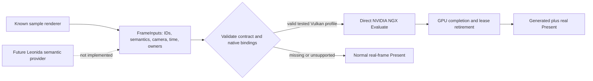

# Architecture

The portable contract does not resolve GPU handles. Vulkan binding validation is separate and currently supports ordered producer/consumer recording in the same command buffer and queue. External signal descriptions exist in the schema but the current GPU consumer rejects them until wait/ownership support is implemented and tested.

Image leases retain actual GBuffer allocations and their allocator. Resource generation, source-frame continuity and reset history prevent stale temporal reuse. A rejected input does not advance the accepted sequence and must not record NGX work. The next valid frame resets history.

The sample's SR route uses Streamline separately. Combined SR + direct NGX FG is not validated. The normal presenter is a diagnostic reference, not the official Streamline FG pacer. Physical scanout and input latency require separate measurement.
