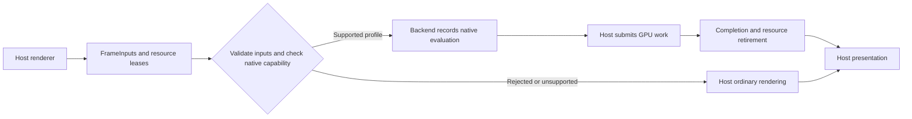

# Architecture

FrameLab separates the portable temporal contract from backend execution. [Repository status and hardware evidence](../README.md) distinguish merged components from work verified in open PRs.

The diagram summarizes responsibility and lifetime. The host schedules presentation and any additional GPU reads of the output. Their completion determines when presentation-owned resources can be reused.

The portable contract validates same-frame inputs, resource generations and temporal history without resolving native GPU handles. A rejected packet leaves the accepted sequence unchanged. The host can render normally and reset history on recovery. A native recording failure may leave partial commands. Discard work that cannot be submitted before cancelling, following the backend contract.

[D3D12FG](sdk/D3D12_FG.md) and [D3D12SR](sdk/D3D12_SR.md) record Direct NGX on an application-owned direct list and observe the configured D3D12 fence. The two components own mutually exclusive process sessions until FL-16. [VulkanSR](sdk/VULKAN_SR.md) records Streamline on the configured Vulkan stream and retires against a Vulkan timeline. The older Vulkan FG sample and standalone [Vulkan handoff test](../tests/vulkan-handoff/README.md) exercise separate paths.

The installed Vulkan FG consumer with queue handoff is in [draft #20](https://github.com/5headsmartbtw/leonida-framelab/pull/20). The actual SR → FG chain and its separate-queue variants are verified in [draft #23](https://github.com/5headsmartbtw/leonida-framelab/pull/23) and [draft #27](https://github.com/5headsmartbtw/leonida-framelab/pull/27). [#24](https://github.com/5headsmartbtw/leonida-framelab/issues/24) remains the extended SyncVal release gate. Installed-client D3D12 presentation is tracked in [FL-15](https://github.com/5headsmartbtw/leonida-framelab/issues/30). The older standalone D3D12 presenter is diagnostic evidence. The host owns display scheduling, and physical scanout and input latency need separate measurement.
